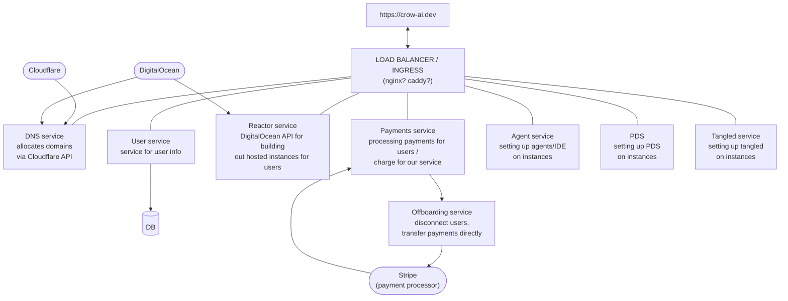

# crow-ai.dev — "a website for setting up websites"

Transcribed from the whiteboard (webcam 4, 2026-11-21). The product: a user
signs up at crow-ai.dev, pays via Stripe, and gets a hosted instance
provisioned on DigitalOcean with a domain (Cloudflare), a crow agent + IDE,
a PDS, and tangled — with offboarding that disconnects cleanly and transfers
payments directly.

## Reading of the board

- **crow-ai.dev** sits behind one **load balancer / ingress** — the board
  leaves the choice open: *nginx? caddy?*
- Seven services hang off the ingress bus: **DNS**, **User**, **Reactor**,
  **Payments**, **Agent**, **PDS**, **Tangled**.
- **External providers** (ellipses on the board): Cloudflare (domains/DNS),
  DigitalOcean (instances), Stripe (payments).
- **User service** owns the database (the cylinder).
- **Offboarding service** hangs below payments: disconnect users, transfer
  payments directly (back out through Stripe).
- The three "on instances" services (Agent, PDS, Tangled) configure what
  Reactor provisions — the instance itself is implied, not drawn as a box.
