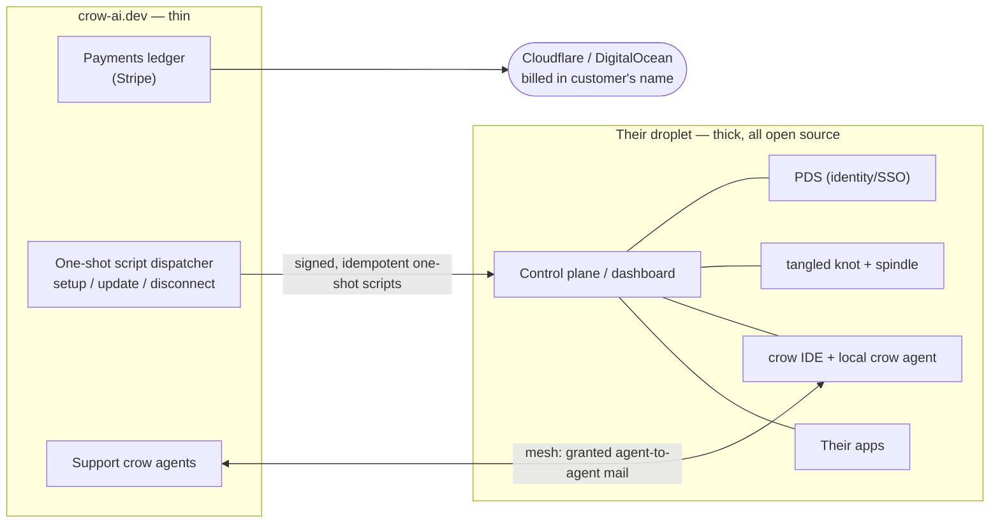

# crow-ai.dev — "a website for setting up websites"

Transcribed from the whiteboard (webcam 4, 2026-11-21). The product: a user
signs up at crow-ai.dev, pays via Stripe, and gets a hosted instance
provisioned on DigitalOcean with a domain (Cloudflare), a crow agent + IDE,
a PDS, and tangled — with offboarding that disconnects cleanly and transfers
payments directly.

## Reading of the board

- **crow-ai.dev** sits behind one **load balancer / ingress** — the board
  leaves the choice open: *nginx? caddy?*
- Seven services hang off the ingress bus: **DNS**, **User**, **Resource**,
  **Payments**, **Agent**, **PDS**, **Tangled**.
- **External providers** (ellipses on the board): Cloudflare (domains/DNS),
  DigitalOcean (instances), Stripe (payments).
- **User service** owns the database (the cylinder).
- **Offboarding service** hangs below payments: disconnect users, transfer
  payments directly (back out through Stripe).
- The three "on instances" services (Agent, PDS, Tangled) configure what
  Resource provisions — the instance itself is implied, not drawn as a box.

## The control-plane split (Thomas's correction, 2026-11-21)

The control plane lives on THEIR side. crow-ai.dev is thin: a payments
ledger, a one-shot script dispatcher, and a fleet of support agents.
Everything installed on the customer's droplet — dashboard, PDS, tangled,
crow IDE, apps — is open source and administered on their side.

- We charge an up-front setup fee, then charge providers in the customer's
  name (their card, their accounts). Our recurring fee is for the managed
  version only.
- The disconnect/"fuck off" button works by construction: we stop billing
  and stop firing scripts. Nothing proprietary runs on their box, so there
  is nothing to take away. Exit is not a promise, it's the absence of a
  dependency.
- The managed version's value IS the support: our crow agents talk to their
  crow agents to diagnose, fix, and deploy across the mesh of managed
  services. Support tickets are the product, not a cost center.

The agent mesh from the earlier research is not a separate product — it is
the managed-support transport: per-customer grants (customer consents to our
support agent addressing their agent), durable mailboxes as the ticket
queue, authenticated cross-host delivery. The script channel and the agent
channel share one security model: node keys, signed payloads, deny-by-default
grants.
